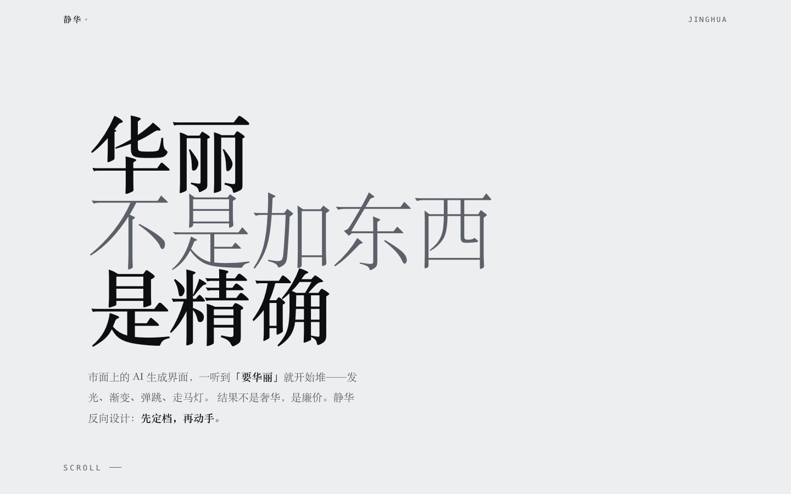

# 静华 · Jinghua

> 高级感 + 华丽动画的 Agent Skill。
>
> 一句话说清核心矛盾：**华丽不是加东西，是精确。**

市面上的 AI 生成 UI，一听到"要华丽"就开始堆动效——发光、渐变、弹跳、走马灯。结果不是奢华，是廉价。

静华反向设计：**先定档，再动手**；**先挑毛病，再改**；**宁可少做，不做错**。



## 它解决什么

让 AI agent 做出来的界面，具备"贵"的感觉，而不是"AI 味"。

- **定级驱动** — 静奢 / 动奢 / 静默三档，动效预算不同。默认静奢。
- **审查优先** — 动手前先按 6 个维度打分，输出 P0–P3 分级问题清单。
- **禁飞区** — 9 条一犯就廉价的规则（弹跳缓动、彩色发光、径向光晕、紫蓝渐变、渐变文字、走马灯、脉冲点、卡片套卡片、边缘色条）。
- **修复有词** — 按问题类型选动作（bolder / quieter / typeset / layout / delight / overdrive / polish），一次只改一处。

## 谁适合用

- 给产品做落地页，但不想做成"又一个 AI 创业页"
- 做作品集，需要精致但不浮夸
- 已有页面想升级质感，但不知道从哪下手

## 安装

把 `skills/premium-motion-design/` 拷进你的 agent 技能目录即可。

```bash
cp -r skills/premium-motion-design ~/.your-agent/skills/
```

## 配套检测器（可选但强烈推荐）

静华的工作流依赖 [impeccable](https://github.com/pbakaus/impeccable) 的本地检测器提供客观数据：

```bash
npm install -g impeccable
impeccable detect src/                    # 扫源码
impeccable detect http://localhost:5173   # 扫渲染后的页面
```

62 条规则，纯本地运行，不需要 API key，不需要联网。

## 工作流

```
需求
 └─ ① 定档（静奢 / 动奢 / 静默）
     └─ ② 建（按档位给动效预算）
         └─ ③ 审（6 维度打分 + 检测器扫描）
             └─ ④ 改（P0→P3，一次一处，改完复检）
                 └─ ⑤ 交付（过一遍自检清单）
```

## 三条最容易翻车的反模式

| 反模式 | 为什么错 |
|---|---|
| 动效太多 = 没有动效 | 整页都在动，眼睛无处停。每屏留一处"静" |
| 时长太长 = 卡顿 | 入场超过 800ms 就让人等。单元素 400–700ms |
| 什么都要发光 = 什么都不亮 | 发光只在暗背景、只在 1 个元素上有意义 |

## 与同类项目的关系

- **[taste-skill](https://github.com/Leonxlnx/taste-skill)** — 强在"从零建页"的模具和五尺寸验收。静华复用了它的验收思路。
- **[impeccable](https://github.com/pbakaus/impeccable)** — 强在"设计的词汇"。静华用它的检测器做客观审查，用它的命令名做修复动作。
- **静华** — 回答它们都没回答的问题：**高级感和华丽如何共存**。

## License

MIT

